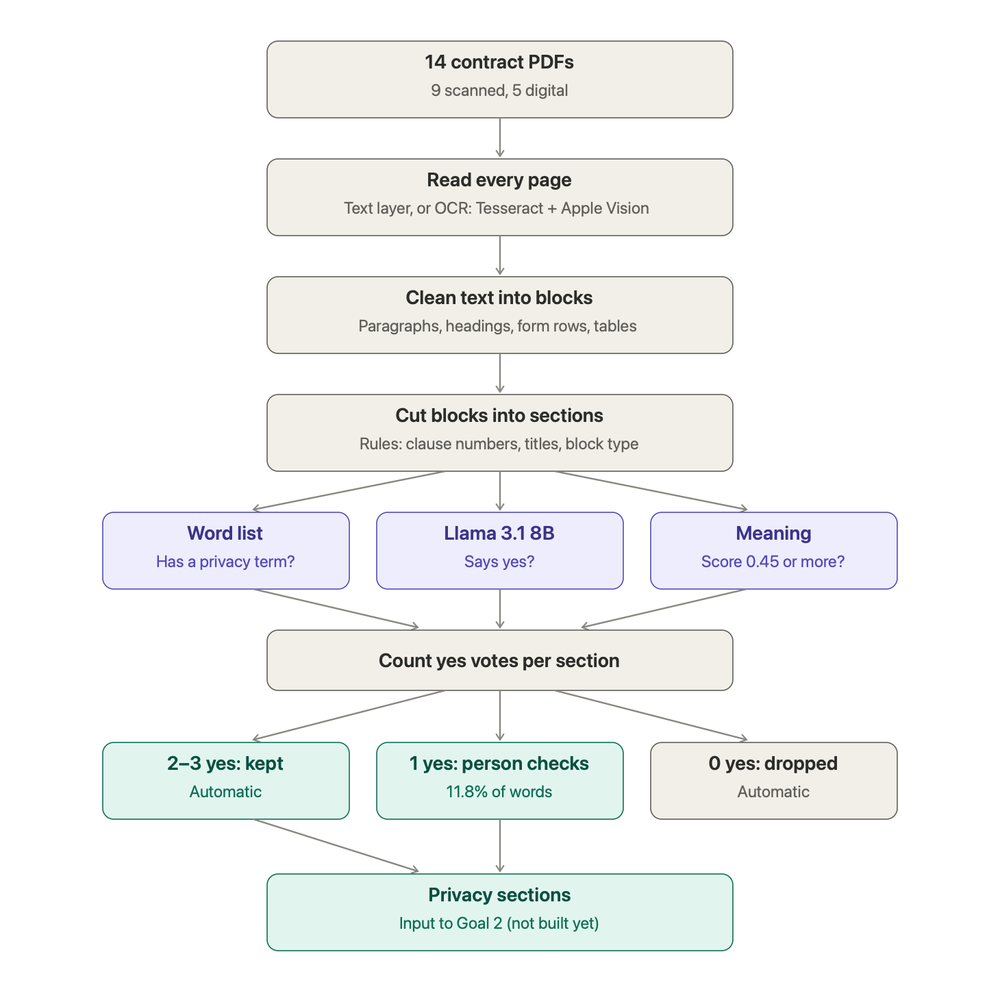

# Instructure contracts: segmentation and information-extraction benchmark

My benchmark project for Q4 2026. It uses the 14 contract files between Instructure Inc. and Nebraska
universities and colleges (one file, F09, is a California college's agreement that was in the same folder). It
has two goals:
1. Split each contract into meaningful pieces and find the ones about data governance and privacy (narrowed from
   several topics to this one; decisions.md, P1).
2. On that text, compare several ways of extracting specific facts (data ownership, data use, data deletion).

The work is kept separate from the earlier `../contract_pipeline` and `../segmentation_pilot`, which covered both
vendors at the clause level. Instructure's files are the harder test: 9 of 14 are scans, and they are mostly
tables and forms.



**Where to read:**
- [docs/decisions.md](docs/decisions.md): every decision, in plain language, with the numbers behind it.
- [docs/what_failed.md](docs/what_failed.md): what did not work, with examples.
- To read both as formatted pages in a browser, run `.venv/bin/python -m bench.review docs` and open
  `work/review/decisions.html` (rerun after editing either `.md` file).

## Status

| Step | What it does | State |
|---|---|---|
| `read` | Turn every page into text: the PDF's own text on digital pages; OCR on the 47 scanned pages | done (final run on the lab server, Oct 29) |
| `ocr-eval` | Score each OCR reading against two answer keys | done |
| `tables` | Read the pricing tables two ways; check them with arithmetic | done |
| `forms` | Read 8 fields from each of the 14 order forms two ways (text rules, layout) and score them | done; answer key checked by me (0 of 112 changed) |
| `text` | Clean, whole text: page numbers and stamps removed, paragraphs joined across lines and pages, checked tables in place | done; F02 and F13 read by a person beside the scans |
| `privacy` | Find data-governance-and-privacy text with a term list, meaning and Llama; a sorter sends disagreements to a person | scored on the tuning files; test files not yet scored; answer key needs a person's check |
| extraction | Privacy facts (goal 2) | not started |

Headline results so far:
- **Reading scanned pages:**
  - The earlier pipeline got 8.8% of characters wrong and 61% of numbers exactly right.
  - Tesseract with Apple Vision filling its gaps gets 0.37% wrong and 100% of numbers right.
  - A second test on 785 lines from digital pages, not used to design anything, ranks the readings in the same
    order (0.39% of characters wrong).
- **Pricing tables:**
  - 88 product rows found.
  - Every subtotal (63/63) and grand total (12/12) adds up.
  - The 7 row checks that fail are printed that way in the contracts themselves.
  - Billing Summary tables (F13, F14) pass all 10 of their arithmetic checks.
- **Order-form fields:**
  - Reading by position on the page (layout) gets 89 of 99 values right.
  - Searching the running text (text rules) gets 84.
  - Layout is far better on signer names and dates. Handwriting defeats both.
- **Clean text** (`outputs/text/F01.md` … `F14.md`, readable next to the PDFs):
  - Page numbers and stamps in the text: 88 → 0.
  - Sentences cut off mid-way: 2,119 → 10.
  - A third OCR engine finds only 3 lines missing.
- **Finding privacy text** (tuning files, contract text; test files not yet scored):
  - Judging one block at a time (found, clean, whole): term list (regex) 100%, 69%, 100%; meaning 73%, 51%, 67%;
    Llama with context 73%, 100%, 53%.
  - Three-way sorter (term list, meaning and Llama vote): all core found after checking, 89% of borderline reaches a
    person, and a person reads 8.6% of the words (decisions.md, P8).

## Running it on the Mac

```bash
.venv/bin/python run.py read ocr-eval tables forms text privacy
```
`read` skips pages already read, and `privacy` reuses the meaning vectors and Llama answers saved in
`work/privacy/`, so neither needs the server again. Score the test files only once, after the answer key is checked
and nothing will change:
```bash
.venv/bin/python run.py privacy-test
```
Setup on a new Mac:
1. Create the environment and install the packages:
   ```bash
   python3.12 -m venv .venv && .venv/bin/pip install -r requirements.txt
   ```
2. Download Tesseract's English model into `.tessdata/` (the link is in `requirements.txt`).

## Pages for checking by eye

| Command | Makes |
|---|---|
| `.venv/bin/python -m bench.review F02` | `work/review/F02.html`: each page of a file next to its clean text (any file ID) |
| `.venv/bin/python -m bench.review forms` | `work/review/order_forms.html`: the order-form answer key next to page pictures |
| `.venv/bin/python -m bench.review privacy` | `work/review/privacy_key.html`: the privacy answer key, coloured over the contract text |
| `.venv/bin/python -m bench.review sheet` | `outputs/privacy/privacy_key_for_review.xlsx`: the privacy key as a workbook for an outside reviewer |
| `.venv/bin/python -m bench.review blocks` | `outputs/privacy/blocks_segmented.xlsx`: every block, its three votes and the sorter's result |
| `.venv/bin/python -m bench.review docs` | `work/review/decisions.html` and `what_failed.html`: the two logs as web pages |

## Running it on the lab server (recommended: keeps your laptop cool)

Apple Vision runs only on a Mac; its readings travel inside the bundle. On your Mac, make the bundle (code, answer
keys, the 14 PDFs, the OCR already done):
```bash
bash "$HOME/Desktop/Educational Contracts/benchmark_segmentation_extraction/make_bundle.sh"
```
Upload it, then log in:
```bash
scp "$HOME/Desktop/Educational Contracts/benchmark_bundle.zip" YOUR_USERNAME@YOUR_SERVER:~/
```
```bash
ssh YOUR_USERNAME@YOUR_SERVER
```
On the server, unpack and set up (first time only):
```bash
unzip -q benchmark_bundle.zip && bash benchmark_segmentation_extraction/server/setup_server.sh
```
Run inside `tmux`, so a dropped connection does not stop it (`tmux attach -t bench` to come back):
```bash
tmux new -s bench
```

**Reading, tables, forms and text** (CPU only). It uses 8 CPU threads by default; on a busy server, put
`THREADS=4` in front to use fewer:
```bash
bash benchmark_segmentation_extraction/server/run_all.sh
```
Zip the results; the script prints an `scp` line to copy into a terminal **on your Mac**:
```bash
bash benchmark_segmentation_extraction/server/pack_results.sh
```
Back on the Mac, unpack the results into this folder (replace the zip name with the one you downloaded):
```bash
unzip -o ~/Desktop/results_DATE.zip -d "$HOME/Desktop/Educational Contracts/benchmark_segmentation_extraction"
```

**Privacy: meaning vectors and Llama** (needs the GPU). Set up once, run, then zip the answers:
```bash
bash benchmark_segmentation_extraction/server/setup_privacy.sh
```
```bash
bash benchmark_segmentation_extraction/server/run_privacy.sh
```
```bash
bash benchmark_segmentation_extraction/server/pack_privacy.sh
```
On your Mac, download and unpack the answers, then score them:
```bash
scp YOUR_USERNAME@YOUR_SERVER:~/benchmark_segmentation_extraction/results_privacy.zip ~/Desktop/
```
```bash
unzip -o ~/Desktop/results_privacy.zip -d "$HOME/Desktop/Educational Contracts/benchmark_segmentation_extraction"
```
```bash
.venv/bin/python run.py privacy
```

When the project is finished, remove everything from the server (it asks you to type DELETE):
```bash
bash benchmark_segmentation_extraction/server/cleanup_server.sh
```

## Still to do

1. A person checks the privacy answer key with `outputs/privacy/privacy_key_for_review.xlsx` (decisions.md, P2).
2. Then score the test files once: `run.py privacy-test`.
3. Goal 2: extract ownership, use and deletion facts from the privacy text.

## Folder map

```
run.py              the entry point: python run.py <steps>
bench/              one file per step: reading.py, ocr_eval.py, tables.py, forms.py, text.py, privacy.py;
                    privacy_server.py (meaning vectors and Llama, run on the server); review.py (pages for checking);
                    common.py (shared helpers)
tools/              vision_ocr.swift (Apple Vision OCR, compiled on first use)
server/             setup, run, pack and cleanup scripts for the lab server
make_bundle.sh      zips the project for the server
data/files.csv      the 14 files and their short IDs F01..F14
data/order_forms.csv  the 14 order forms: file, first page, signature page
data/gold/          answer keys: ocr_lines.csv (+ the line pictures in ocr_crops/), order_form_fields.csv,
                    privacy_passages.csv
data/baseline_docling_rapidocr/   the earlier pipeline's output, for comparison
data/english_words.txt.gz         word list for checking the digital pages' stored text
docs/               decisions.md, what_failed.md, current_pipeline.png (+ .svg)
outputs/            scores and results (made by run.py and bench/review.py)
work/privacy/       saved meaning vectors and Llama answers (kept in git, so scores rerun without the server)
work/               everything else in it is made by run.py and not in git: page pictures, raw OCR, cell re-reads
```
The contract PDFs are not in the repo. They are read from `../Instructure Contracts/`, or from `contracts/` inside
the server bundle.
